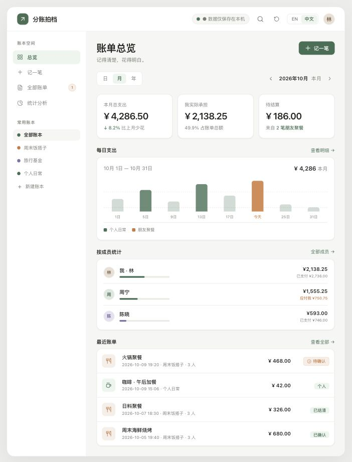
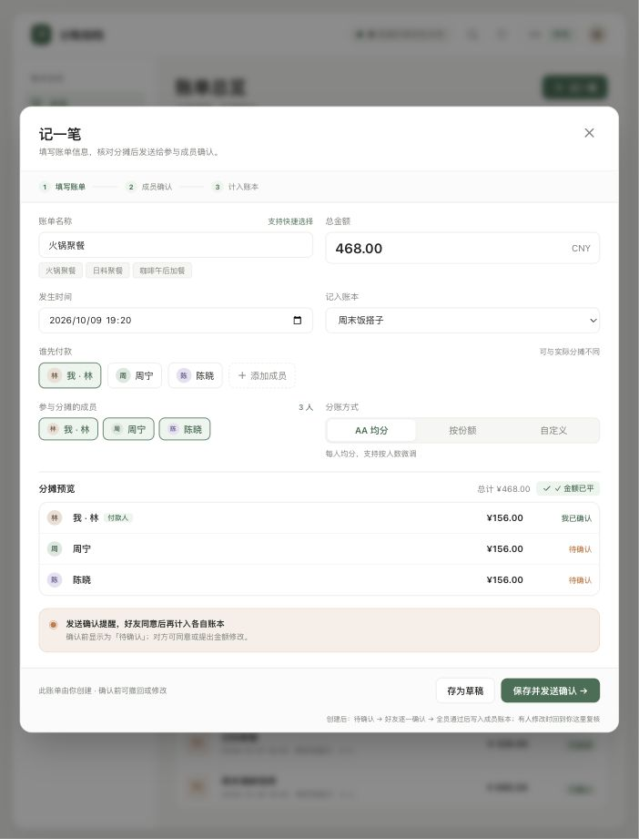
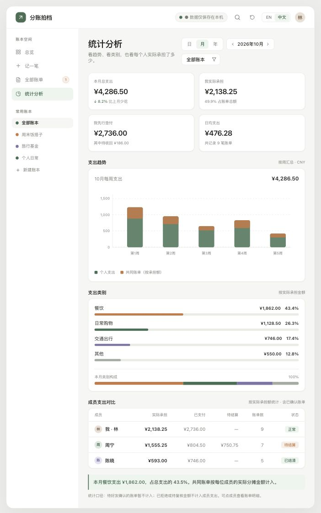

<div align="center">

# TabMate · 分账拍档

**记得清楚，花得明白。**

一款把个人记账与多人分账放在一起的 Web 应用。<br>
聚餐、旅行、合租日常，从谁先垫付到每人承担，都有据可查。


[产品预览](#产品预览) · [使用演示](#使用演示) · [本地启动](#本地启动) · [开启云端协作](#开启云端协作)

</div>



## 为一起花钱的日常设计

| 场景 | 用 TabMate 怎么记 |
| --- | --- |
| 朋友聚餐 | 一人先付，选择参与成员，按 AA 均分后逐一确认 |
| 结伴旅行 | 单独建一个旅行账本，用份额或自定义金额记录不同承担 |
| 合租生活 | 把共同开销归入同一账本，区分付款人与实际分摊成员 |
| 个人日常 | 只选自己参与分摊，记录咖啡、购物与通勤等日常花费 |

- **三种分账方式**：AA 均分、按份额、自定义金额，保存前核对分摊预览。
- **成员确认流程**：共同账单先进入待确认；支持查看确认进度和提出金额修改建议。
- **多账本管理**：按场景建立账本，结合搜索和状态筛选查找账单。
- **总览与统计页面**：查看支出概况、成员承担与付款金额；当前部分图表仍为示例展示，详见下方说明。
- **中英切换**：通过顶部「中文 / EN」切换界面语言。
- **两种使用模式**：无需账号体验本地示例；配置 Supabase 后使用邮箱登录与云端账本。

## 产品预览

以下四张截图均来自当前代码运行的**本地示例模式**，使用仓库内置虚构数据。

<details>
<summary><strong>记一笔 · 填写账单，实时预览分摊</strong></summary>

填写金额、账本与付款人，再选择参与成员和分账方式。图中为 468 元火锅聚餐，三人各承担 156 元。



</details>

<details>
<summary><strong>成员确认 · 每个人的分摊都有进度</strong></summary>

查看每位参与者的金额与确认状态。本地模式提供模拟确认按钮；云端模式只能确认当前登录用户自己的分摊。


</details>

<details>
<summary><strong>统计分析 · 看支出，也看实际承担</strong></summary>

展示支出趋势、类别构成与成员对比。待确认账单不计入已确认账单汇总。



</details>

## 使用演示

以「三人聚餐，一人垫付 468 元」为例，启动后即可跟着体验：

1. **选择账本**：在左侧选择「周末饭搭子」，也可以点击「新建账本」建立自己的场景。
2. **记一笔**：点击「记一笔」，填写「火锅聚餐」、金额 `468`，核对发生时间和所属账本。
3. **设置分摊**：选择付款人，勾选三位参与成员，再选择「AA 均分」。预览应为每人 `¥156.00`，并显示「金额已平」。
4. **保存并请求确认**：点击「保存并发送确认 →」，共同账单会进入「待确认」状态。
5. **查看成员确认**：打开这笔账单，在本地模式点击「模拟 … 确认」逐一体验，也可以使用「一键全员确认」。全员通过后账单变为「已确认」。
6. **回看账单**：进入「全部账单」按状态筛选，或打开「统计分析」查看已确认账单汇总与成员对比。

想直接体验确认步骤，也可以打开示例中已有的「火锅聚餐」待确认账单。

> 本地模式中的确认只用于演示，不会向真实好友发送通知。云端协作需先完成下方 Supabase 配置，并让好友加入共同账本。

## 本地启动

建议使用 **Node.js 22 LTS**，并准备 npm 或 pnpm。

```bash
git clone https://github.com/MoguCiao/tab-mate.git
cd tab-mate
npm install
npm run dev
```

打开终端显示的地址，默认是 **http://localhost:3000**。未配置 Supabase 时，直接进入本地示例模式，无需注册。

仓库附带 `pnpm-lock.yaml`，也可以使用 `pnpm install --frozen-lockfile` 和 `pnpm dev` 启动。

| 命令 | 用途 |
| --- | --- |
| `npm run dev` | 启动本地开发服务器 |
| `npm run typecheck` | 检查 TypeScript 类型 |
| `npm run build` | 构建静态文件到 `dist/` |
| `npm run preview` | 本地预览构建结果 |

## 开启云端协作

| | 本地示例模式 | Supabase 模式 |
| --- | --- | --- |
| 开始使用 | 启动即可体验内置示例 | 配置后通过邮箱注册 / 登录 |
| 数据位置 | 当前浏览器的 localStorage | Supabase 云端数据库 |
| 成员协作 | 本地成员与模拟确认 | 好友码申请、接受申请、加入共同账本 |
| 跨设备使用 | 数据不自动跨浏览器或设备同步 | 登录同一账号加载云端账本 |
| 分摊确认 | 可模拟其他成员确认 | 只能确认自己的分摊 |

### 1. 配置环境变量

在 Supabase 项目设置中复制 Project URL 和 publishable / anon key：

```bash
cp .env.example .env.local
```

编辑 `.env.local`：

```dotenv
VITE_SUPABASE_URL=https://your-project-id.supabase.co
VITE_SUPABASE_ANON_KEY=your-supabase-publishable-or-anon-key
```

前端只填写 publishable / anon key，**不要填写 service role key**。`.env.local` 已被 Git 忽略。

### 2. 初始化数据库与登录

1. 在 Supabase SQL Editor 执行 [`supabase/schema.sql`](supabase/schema.sql)，创建数据表、RLS 策略和好友码 RPC。
2. 在 Auth 设置中，将 Site URL 设为本地站点地址，并启用邮箱验证；将本地与正式站点地址加入 Redirect URL。
3. 重启 `npm run dev`，进入邮箱注册 / 登录页面。完成邮箱验证后登录。

### 3. 邀请好友一起记账

1. 打开「好友与邀请」，复制自己的好友码，或输入对方好友码发送申请。
2. 对方接受申请后，在「邀请好友加入账本」中选择账本并点击 `+`。
3. 好友加入共同账本后，再创建共同账单，由各自账号确认分摊。

接受好友申请后，**仍需单独把好友加入账本**。本地示例数据不会自动迁移为云端账本。

## 数据与当前边界

- 本地数据只保存在当前浏览器。清除站点数据会删除这些记录；「重置示例数据」会覆盖本地账单、成员和账本。
- Supabase 模式的数据保存在云端，依赖项目数据库和 Auth 配置。
- 当前仍是持续完善中的版本：部分趋势图、类别金额、环比和待结算指标使用固定示例值，日期切换尚未完整连接统计计算。请将这些图表用于体验界面；成员承担与付款等已接入账单汇总的部分，也需结合账单明细核对。

## 项目结构

```text
src/
├── components/       # 记账、成员确认、账本、好友与登录组件
├── views/            # 总览、全部账单、统计分析
├── locales/          # 中英文文案
├── types/            # 账单、账本与成员类型
└── utils/            # 本地存储、Supabase 与格式化逻辑
supabase/schema.sql   # 数据库结构、RLS 与 RPC
docs/images/          # README 真实界面截图
```

<div align="center">

**一起花的钱，一起记明白。**

</div>
